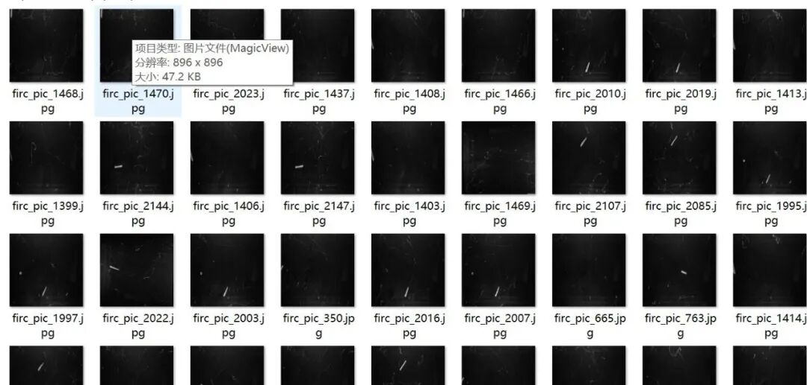
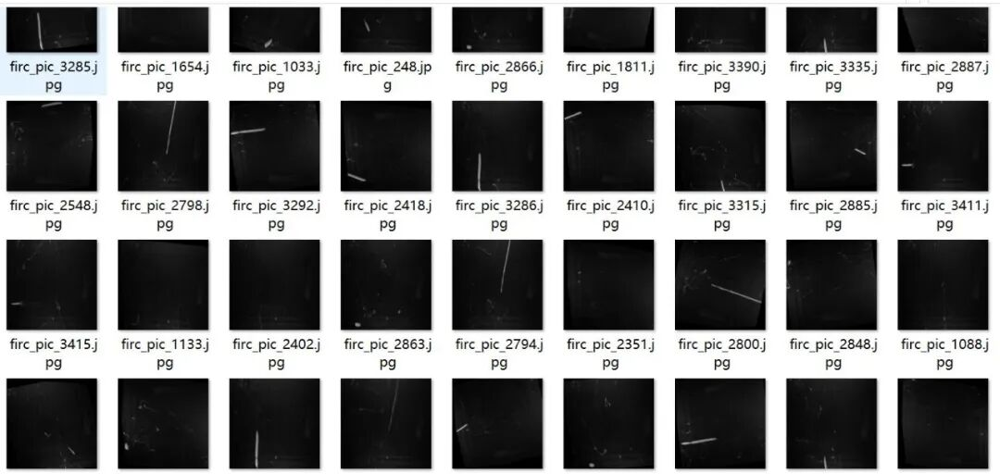
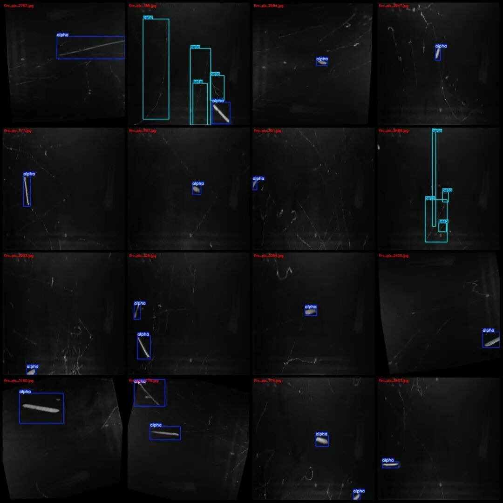
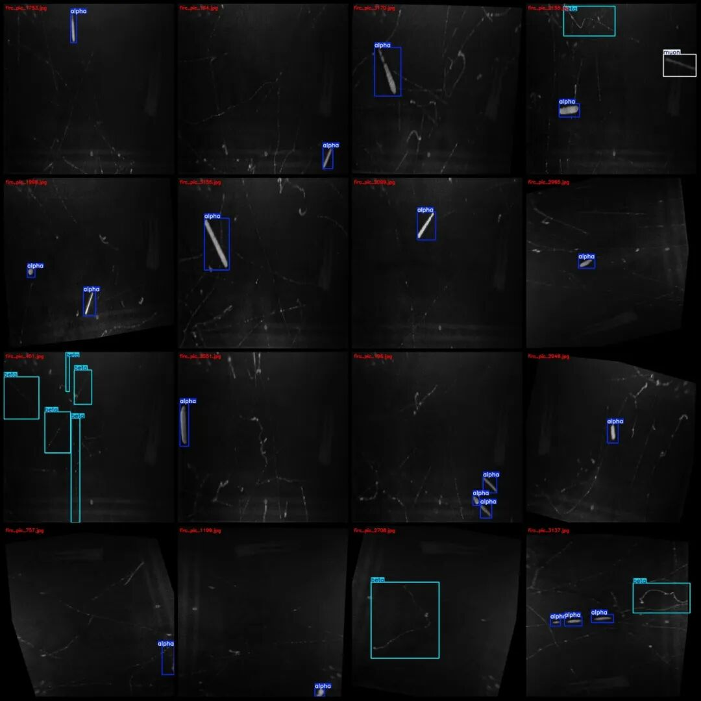

# Cloud Chamber Particle Detection Classification Data Set for Recognizing Alpha Particles, Beta Particles, and Muon Detection in VOC+YOLO format with 1465 images in 3 categories

Dataset format: Pascal VOC format + YOLO format (txt file without split path, only containing jpg images and corresponding VOC format xml files and yolo format txt files)

Number of images (number of jpg files): 1465

Number of annotations (number of xml files): 1465

Number of annotations (number of txt files): 1465

Label category count: 3

Label category names (Note that the order of yolo format categories does not correspond to this, but is based on the classes.txt in the labels folder): ["alpha", "beta", "muon"]

Number of boxes labeled in each category:

Alpha Frame Count = 1562

Beta Frames = 1241

muon Frames = 56

Total frame count: 2859

Number of images per category:

Alpha's number of images owned = 1300

Beta occupies the number of images = 449

muon occupancy count = 53

Image resolution: 896x896

Using labelImg:

Annotation rules: Draw a rectangle around the category.

Important Notice: The dataset does not have separate training, validation, and test sets; you need to partition them yourself.

Special : This dataset does not guarantee the accuracy of the trained models or weight files.

Image Preview:

Annotation example:

## Payment

Here is a pay link on Stripe ( https://buy.stripe.com/3cs8yP7sY87d0vu9AB ). Please contact me lonlonago@foxmail.com after funding $89, and I will send you a complete data files , thank you!

